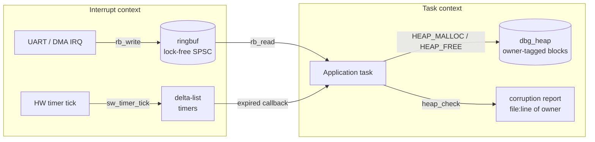
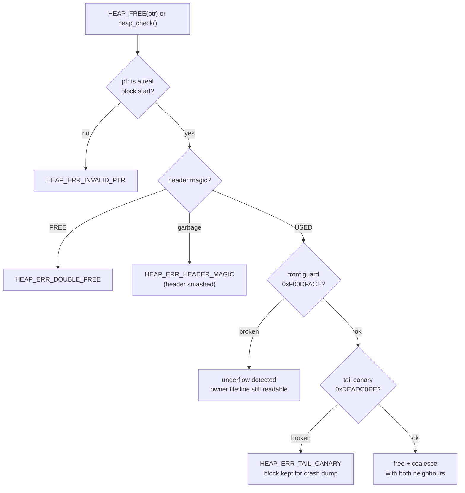
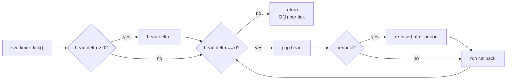

# embedded-c-systems

[](https://github.com/ribhu0908/embedded-c-systems/actions/workflows/ci.yml)

Three building blocks every firmware platform ends up needing, written in portable C11 with **no libc allocation, no OS dependency, and full host unit tests under AddressSanitizer + UBSan**.

| Module | What it solves | Key idea |
|---|---|---|
| [`dbg_heap`](src/dbg_heap.c) | Heap corruption that only shows up as a random crash hours later | Every block records its **owner (file:line)**, a front guard and a tail canary; `heap_check()` walks the arena and names the first corrupted block *and who allocated it* |
| [`ringbuf`](src/ringbuf.c) | Moving bytes from an ISR to a task without locks | Lock-free **SPSC** ring, power-of-two capacity, free-running indices, C11 acquire/release ordering |
| [`sw_timer`](src/sw_timer.c) | Hundreds of software timers on one hardware tick | **Delta list** (as in RTOS kernels): O(1) work per tick, FIFO for equal expiries, periodic + one-shot, restart-from-callback safe |

## Architecture



## Build & test

```sh
make test        # gcc, -Wall -Wextra -Werror -Wconversion
make sanitize    # AddressSanitizer + UndefinedBehaviorSanitizer
make CC=clang    # clang
make demo        # heap catching a real overflow, double free and leaks
make arm         # cross-compile for Cortex-M4 (needs arm-none-eabi-gcc)
```

CI runs all of the above on every push.

## Demo output

```
after 3 allocations:       heap_check -> OK
after bad strcpy:          heap_check -> OVERFLOW (tail canary)  | block @+128 allocated at examples/demo.c:31
  HEAP_FREE(gps_buf) -> refused, block kept for crash dump
  HEAP_FREE(uart_rx) twice -> DOUBLE FREE caught

stats: used=80 peak=144 free=1736 largest_free=1660 live=2
live allocations at shutdown:
  LEAK   32 bytes  <- examples/demo.c:31
  LEAK   48 bytes  <- examples/demo.c:32
```

Footprint on Cortex-M4 (`-Os`, Thumb-2): **dbg_heap 1.2 KB, ringbuf 380 B, sw_timer 440 B** of flash.

## 1. dbg_heap - a heap that tells you who broke it

```
+--------+-------+----------------------+--------+   +--------+ ...
| header | guard |   user payload       | canary |   | header |
+--------+-------+----------------------+--------+   +--------+ ...
  magic,  0xF00DFACE                      0xDEADC0DE
  span, size, owner file:line
```

```c
static uint8_t arena[16 * 1024];
heap_init(arena, sizeof arena);

char *buf = HEAP_MALLOC(32);    // owner = this file:line, captured by macro
buf[32] = 0;                    // off-by-one overflow

heap_report_t r = heap_check(); // HEAP_ERR_TAIL_CANARY
printf("corrupted block allocated at %s:%d\n", r.owner_file, r.owner_line);
```

How a block is checked:



What it catches:

- **Overflow**: tail canary after every payload
- **Underflow**: front guard sits between the header and the payload, so a negative-index write trips the guard *before* it can destroy the owner info. The report still says who allocated the block.
- **Double free, foreign pointer, interior pointer**: rejected with a status code instead of silently corrupting the free list
- **Smashed size field**: span is validated before any arithmetic, so a corrupt header cannot send the walker outside the arena
- **Leaks**: `heap_walk_allocated()` lists every live block with its owner

Design choices:

- Blocks are contiguous and the next block is found by `header + span`, so there is no stored "next" pointer that a stray write could redirect.
- A block that fails validation on free is **left allocated**, preserving the evidence for a crash dump.
- Free coalesces with both neighbours; `heap_get_stats()` reports peak usage, largest free block and free-block count (fragmentation signal).

## 2. ringbuf - lock-free ISR to task FIFO

```c
static uint8_t rx_storage[256];
static ringbuf_t rx;
rb_init(&rx, rx_storage, sizeof rx_storage);

void UART_IRQHandler(void) { uint8_t c = UART->DR; rb_write(&rx, &c, 1); }
void uart_task(void)       { uint8_t b[32]; size_t n = rb_read(&rx, b, sizeof b); /* ... */ }
```

- Producer writes only `head`, consumer writes only `tail`, so no lock is needed for one producer and one consumer.
- `head` and `tail` are free-running `uint32_t`; `head - tail` is the fill level even across 2^32 wrap (tested).
- Full and empty are distinguishable without sacrificing a slot.

## 3. sw_timer - delta-list software timers

```
due at ticks 5, 8, 8, 20  ->  head -> [5] -> [3] -> [0] -> [12]
```



Each node stores ticks relative to the previous one, so `sw_timer_tick()` only decrements the head. `sw_timer_next_expiry()` returns ticks to the next deadline, which is what a tickless-idle power manager needs to program a one-shot hardware timer.

## Porting notes

- On a target, wrap `sw_timer_start/stop` and `sw_timer_tick` in a critical section if they run in different contexts.
- `dbg_heap` is not thread-safe by design; put it behind the RTOS mutex or use one heap per core.
- Place the arena in a dedicated linker section to inspect it directly from a JTAG/Trace32 memory dump.

## License

MIT
